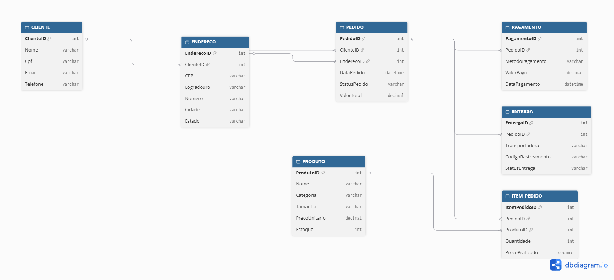

# 🗄️ Modelagem de Banco de Dados — E-commerce 'BleachArt'

Projeto completo de concepção, análise de requisitos e modelagem de banco de dados relacional para uma loja virtual especializada em vestuário personalizado e peças artesanais exclusivas.

> **Status do Projeto:** ✅ Concluído

-----------------------------------------------------------------------

## 🗺️ Roadmap do Projeto

- [x] **Etapa 1:** Definição do Minimundo, Escopo, Atores, Processos e Análise de Dados
- [x] **Etapa 2:** Modelagem Conceitual (Diagrama Entidade-Relacionamento - DER)
- [x] **Etapa 3:** Modelagem Lógica e Normalização (1NF, 2NF e 3NF)
- [x] **Etapa 4:** Implementação Física (Scripts DDL `CREATE TABLE`, DML `INSERT` e Consultas `SELECT`)

-----------------------------------------------------------------------

## Etapa 1: Definição do Minimundo, Escopo, Atores, Processos e Análise de Dados

## 🎯 1. Visão Geral e Objetivos

Este projeto consiste na arquitetura de dados para gerenciar o catálogo de peças exclusivas, o estoque e as vendas online da loja de vestuário personalizado **'BleachArt'**. O sistema atende clientes interessados em moda artesanal e administradores responsáveis pela operação do e-commerce, centralizando pedidos, pagamentos e entregas.

### Objetivos Principais
- **Gerenciar** o catálogo de peças exclusivas, controlando tamanhos, preços e disponibilidade em estoque em tempo real.
- **Registrar** e acompanhar todo o ciclo de vida dos pedidos online, desde a compra até a confirmação do pagamento.
- **Centralizar** o cadastro de clientes e endereços para otimizar o processo de envio e o rastreamento das entregas.

---

## 📐 2. Definição de Escopo

| Escopo Incluso (O que o sistema FAZ) | Escopo Excluso (Fora da fase inicial) |
| :--- | :--- |
| Cadastro de clientes (CPF, e-mail, telefone) e múltiplos endereços. | Gestão de produção artesanal, insumos, tintas e fornecedores. |
| Catálogo de produtos (categoria, tamanho, preço, peça única e estoque). | Emissão fiscal automatizada (NF-e). |
| Fluxo completo de pedidos, itens vendidos e histórico de preços. | Integração em tempo real com APIs de frete/transportadoras. |
| Registro de transações financeiras e status de pagamento. | Processamento interno de cartões (armazena apenas retorno do gateway). |
| Controle logístico de envio e códigos de rastreamento. | Folha de pagamento, fluxo de caixa contábil e cupons complexos. |

---

## 👥 3. Atores e Perfis de Uso

- **Cliente:** Cria e atualiza cadastro, gerencia endereços, consulta catálogo, realiza pedidos, informa pagamento e acompanha entregas.
- **Administrador (Lojista):** Gerencia produtos e estoque, acompanha pedidos, atualiza status de envio e consulta relatórios de vendas.
- **Gateway de Pagamento (Sistema Externo):** Processa transações financeiras (PIX, cartão, boleto) e retorna o status de aprovação ao banco.

---

## ⚙️ 4. Processos Principais (Fluxo de Dados)

1. **Cadastro de Cliente e Endereço:** Coleta dados pessoais e de entrega, valida unicidade de CPF/e-mail e gera identificadores únicos (`ClienteID` e `EnderecoID`).
2. **Gestão de Catálogo:** Coleta especificações da peça artesanal, valida campos obrigatórios e preço unitário, gerando o `ProdutoID` na vitrine.
3. **Pedido e Confirmação de Pagamento:** Valida estoque, calcula total, gera `PedidoID` ("Aguardando Pagamento") e registra itens com preço histórico. Após retorno do gateway, registra `PagamentoID`, altera status para "Pago" e realiza baixa automática no estoque.

---

## 🧱 5. Levantamento Preliminar de Entidades

| Entidade | Descrição e Papel no Sistema |
| :--- | :--- |
| **`CLIENTE`** | Identifica unicamente os compradores e mantém dados de contato e histórico. |
| **`ENDERECO`** | Armazena múltiplos locais de entrega vinculados a cada cliente. |
| **`PRODUTO`** | Controla o catálogo de peças exclusivas, especificações, preços e estoque. |
| **`PEDIDO`** | Registra a transação de compra conectando cliente, endereço e status operacional. |
| **`ITEM_PEDIDO`** | Entidade associativa que detalha produtos, quantidades e preço praticado na venda. |
| **`PAGAMENTO`** | Audita método, valor, data e status de aprovação financeira do pedido. |
| **`ENTREGA`** | Gerencia logística, transportadora, código de rastreamento e status de envio. |

---

## 📊 6. Engenharia de Dados: Conceitos Aplicados

### Dado Bruto vs. Informação Contextualizada
- **`0` →** *A camiseta "Arte Sol e Lua" (Tamanho G) está esgotada* (cruzamento de `QuantidadeEstoque` com identificação do produto).
- **`149.90` →** *O pedido #1042 da cliente Mariana Silva totalizou R$ 149,90* (vinculação de `ValorTotal` ao cliente e itens).
- **`BR987654321SP` →** *Pedido #1042 postado nos Correios e em trânsito* (associação do código à entidade `ENTREGA`).
- **`80060-000` →** *Curitiba (PR) concentra 45% dos pedidos do trimestre* (agrupamento geográfico de `ENDERECO` x `PEDIDO`).

### Classificação Estrutural dos Dados
- **Dados Estruturados (Armazenamento Relacional):** CPF do cliente (`VARCHAR`), Preço unitário (`DECIMAL`), Data/hora do pedido (`TIMESTAMP`).
- **Dados Não Estruturados (Object Storage / Referência via URL):** Fotografias em alta resolução das peças (`.jpg`/`.png`), vídeos curtos de demonstração (`.mp4`) e mensagens livres/áudios de suporte.

-----------------------------------------------------------------------

## Etapa 2: Modelagem Conceitual (Diagrama Entidade-Relacionamento - DER)

### 📋 Detalhamento da Modelagem Conceitual (DER)

#### 1. Relação de Entidades e Atributos
* **CLIENTE**: `ClienteID (PK)`, `Nome`, `Cpf`, `Email`, `Telefone`
* **ENDERECO**: `EnderecoID (PK)`, `ClienteID (FK)`, `CEP`, `Logradouro`, `Numero`, `Cidade`, `Estado`
* **PRODUTO**: `ProdutoID (PK)`, `Nome`, `Categoria`, `Tamanho`, `PrecoUnitario`, `Estoque`
* **PEDIDO**: `PedidoID (PK)`, `ClienteID (FK)`, `EnderecoID (FK)`, `DataPedido`, `StatusPedido`, `ValorTotal`
* **ITEM_PEDIDO**: `ItemPedidoID (PK)`, `PedidoID (FK)`, `ProdutoID (FK)`, `Quantidade`, `PrecoPraticado`
* **PAGAMENTO**: `PagamentoID (PK)`, `PedidoID (FK)`, `MetodoPagamento`, `ValorPago`, `StatusPagamento`, `DataPagamento`
* **ENTREGA**: `EntregaID (PK)`, `PedidoID (FK)`, `Transportadora`, `CodigoRastreamento`, `StatusEntrega`

#### 2. Relacionamentos e Cardinalidades
* **CLIENTE 1 : N ENDERECO**: Um cliente pode possuir múltiplos endereços cadastrados, mas cada endereço pertence a um único cliente.
* **CLIENTE 1 : N PEDIDO**: Um cliente pode realizar vários pedidos ao longo do tempo, mas cada pedido é efetuado por um único cliente.
* **PEDIDO N : 1 ENDERECO**: Um pedido é vinculado a um endereço de entrega específico, enquanto um endereço pode atender a vários pedidos.
* **PEDIDO 1 : N ITEM_PEDIDO N : 1 PRODUTO**: Relação N para M resolvida pela entidade associativa `ITEM_PEDIDO`, onde um pedido contém vários itens e cada item referencia um produto do catálogo.
* **PEDIDO 1 : 1 PAGAMENTO**: Cada pedido possui exatamente uma transação financeira correspondente.
* **PEDIDO 1 : 1 ENTREGA**: Cada pedido gera exatamente um registro logístico de rastreio e envio.

-----------------------------------------------------------------------

## Etapa 3: Modelagem Lógica e Normalização (1FN, 2FN e 3FN)

Nesta etapa, o modelo de dados passou por rigorosos ciclos de auditoria relacional, garantindo total conformidade com as Formas Normais e a eliminação de redundâncias e anomalias operacionais.

### 🔄 Processo de Normalização Aplicado
* **Primeira Forma Normal (1FN - Atomicidade):** Garantida a atomicidade de todos os atributos e eliminação de valores multivalorados ou grupos repetitivos. A lista de itens de uma compra foi isolada na entidade associativa `ITEM_PEDIDO`.
* **Segunda Forma Normal (2FN - Dependência Funcional Total):** Validação de que todas as colunas não-chave dependem integralmente da chave primária. Como todas as 7 entidades utilizam chaves primárias simples (identificadores únicos/surrogate), o modelo atende nativamente à 2FN sem dependências parciais.
* **Terceira Forma Normal (3FN - Eliminação de Dependência Transitiva):** Auditoria concluída e sem anomalias, assegurando que nenhum atributo não-chave depende de outro atributo não-chave. Foram isolados:
  * **Domínio de Endereços (`ENDERECO`):** Separação dos dados de localização para evitar dependências transitivas em relação ao cliente ou pedido.
  * **Domínios Logístico e Financeiro (`PAGAMENTO` e `ENTREGA`):** Desacoplamento de dados de transações e transporte da tabela central de pedidos através de chaves estrangeiras (`PedidoID`).

### 📐 Diagrama Entidade-Relacionamento (DER) Lógico
O modelo relacional final, composto pelas 7 entidades validadas (`CLIENTE`, `ENDERECO`, `PRODUTO`, `PEDIDO`, `ITEM_PEDIDO`, `PAGAMENTO` e `ENTREGA`) e pelas respetivas cardinalidades, encontra-se representado abaixo:



-----------------------------------------------------------------------

## Etapa 4: Implementação Física e Manipulação de Dados (DDL, DML e Consultas)

Nesta etapa, o modelo lógico foi implementado fisicamente no Sistema Gerenciador de Banco de Dados (SGBD) **MySQL 8.0**, utilizando o **MySQL Workbench 8.0** como interface de gerenciamento na porta padrão `3306`.

### ⚙️ 1. Ambiente e Configuração
- **SGBD:** MySQL Community Server 8.0 (Instância local *Standalone*).
- **Ferramenta Visual:** MySQL Workbench 8.0.
- **Database (Schema):** `bleachart`

### 🏗️ 2. Scripts de Criação da Estrutura (DDL)
A criação das tabelas respeitou rigorosamente a normalização (3FN), estabelecendo chaves primárias (`PRIMARY KEY`), chaves estrangeiras (`FOREIGN KEY`) e restrições de unicidade (`UNIQUE` e `NOT NULL`):

```sql
CREATE DATABASE IF NOT EXISTS bleachart;
USE bleachart;

-- Tabela CLIENTE
CREATE TABLE IF NOT EXISTS CLIENTE (
    id_cliente INT AUTO_INCREMENT PRIMARY KEY,
    nome VARCHAR(100) NOT NULL,
    email VARCHAR(100) UNIQUE NOT NULL,
    telefone VARCHAR(20)
);

-- Tabela ENDERECO
CREATE TABLE IF NOT EXISTS ENDERECO (
    id_endereco INT AUTO_INCREMENT PRIMARY KEY,
    cep VARCHAR(10) NOT NULL,
    rua VARCHAR(150) NOT NULL,
    numero VARCHAR(20) NOT NULL,
    bairro VARCHAR(50) NOT NULL,
    cidade VARCHAR(50) NOT NULL,
    estado VARCHAR(2) NOT NULL,
    id_cliente INT,
    FOREIGN KEY (id_cliente) REFERENCES CLIENTE(id_cliente) ON DELETE CASCADE
);

-- Tabela PRODUTO
CREATE TABLE IF NOT EXISTS PRODUTO (
    id_produto INT AUTO_INCREMENT PRIMARY KEY,
    nome_produto VARCHAR(100) NOT NULL,
    descricao TEXT,
    preco DECIMAL(10,2) NOT NULL,
    estoque INT NOT NULL DEFAULT 0
);

-- Tabela PEDIDO
CREATE TABLE IF NOT EXISTS PEDIDO (
    id_pedido INT AUTO_INCREMENT PRIMARY KEY,
    data_pedido DATE NOT NULL,
    status_pedido VARCHAR(50) NOT NULL,
    id_cliente INT,
    FOREIGN KEY (id_cliente) REFERENCES CLIENTE(id_cliente)
);

-- Tabela ITEM_PEDIDO
CREATE TABLE IF NOT EXISTS ITEM_PEDIDO (
    id_item INT AUTO_INCREMENT PRIMARY KEY,
    id_pedido INT,
    id_produto INT,
    quantidade INT NOT NULL,
    preco_unitario DECIMAL(10,2) NOT NULL,
    FOREIGN KEY (id_pedido) REFERENCES PEDIDO(id_pedido),
    FOREIGN KEY (id_produto) REFERENCES PRODUTO(id_produto)
);

-- Tabela PAGAMENTO
CREATE TABLE IF NOT EXISTS PAGAMENTO (
    id_pagamento INT AUTO_INCREMENT PRIMARY KEY,
    forma_pagamento VARCHAR(50) NOT NULL,
    status_pagamento VARCHAR(50) NOT NULL,
    valor_pago DECIMAL(10,2) NOT NULL,
    id_pedido INT,
    FOREIGN KEY (id_pedido) REFERENCES PEDIDO(id_pedido)
);
```

### 📥 3. Povoamento de Dados (DML - INSERT)
O carregamento inicial respeitou a hierarquia de dependências (entidades independentes primeiro, seguidas pelas dependentes):

```sql
-- Inserção de Clientes
INSERT INTO CLIENTE (nome, email, telefone) VALUES 
('Ana Souza', 'ana.souza@email.com', '41988881111'),
('Carlos Lima', 'carlos.lima@email.com', '41977772222');

-- Inserção de Endereços
INSERT INTO ENDERECO (cep, rua, numero, bairro, cidade, estado, id_cliente) VALUES 
('80060000', 'Rua XV de Novembro', '1000', 'Centro', 'Curitiba', 'PR', 1),
('80045250', 'Rua Ubaldino do Amaral', '250', 'Alto da XV', 'Curitiba', 'PR', 2);

-- Inserção de Produtos
INSERT INTO PRODUTO (nome_produto, descricao, preco, estoque) VALUES 
('Camiseta BleachArt Alice in Chains', 'Camisa preta personalizada com técnica de bleach art', 89.90, 15),
('Moletom Canguru Gótico', 'Moletom preto com estampa ornamental em aerógrafo', 169.90, 10);

-- Inserção de Pedidos e Itens
INSERT INTO PEDIDO (data_pedido, status_pedido, id_cliente) VALUES ('2026-11-18', 'Processando', 1);
INSERT INTO ITEM_PEDIDO (id_pedido, id_produto, quantidade, preco_unitario) VALUES (1, 1, 2, 89.90);
INSERT INTO PAGAMENTO (forma_pagamento, status_pagamento, valor_pago, id_pedido) VALUES ('Cartão de Crédito', 'Aprovado', 179.80, 1);
```

### 🔍 4. Consultas Exploratórias (`SELECT`)
Consultas desenvolvidas para geração de relatórios combinando tabelas através de INNER JOIN, filtros e ordenação:

```sql
-- Relatório detalhado de pedidos por cliente
SELECT c.nome AS cliente, p.id_pedido, p.data_pedido, p.status_pedido 
FROM CLIENTE c 
INNER JOIN PEDIDO p ON c.id_cliente = p.id_cliente 
WHERE p.status_pedido = 'Processando' 
ORDER BY p.data_pedido DESC;
```

### 🔄 5. Manutenção e Exclusão Segura (`UPDATE e DELETE`)
Comandos executados com rigoroso controle da cláusula WHERE para evitar alterações indevidas:

```sql
-- Atualização de status do pedido
UPDATE PEDIDO SET status_pedido = 'Enviado' WHERE id_pedido = 1;

-- Exclusão condicionada de registo de pagamento
DELETE FROM PAGAMENTO WHERE id_pagamento = 1;
```

-----------------------------------------------------------------------

## 🛠️ Tecnologias e Ferramentas
* **Modelagem e Diagramação:** [dbdiagram.io](https://dbdiagram.io/) (DBML)
* **Banco de Dados e SGBD:** MySQL Community Server 8.0 & MySQL Workbench 8.0
* **Gestão de Versão:** Git & GitHub
